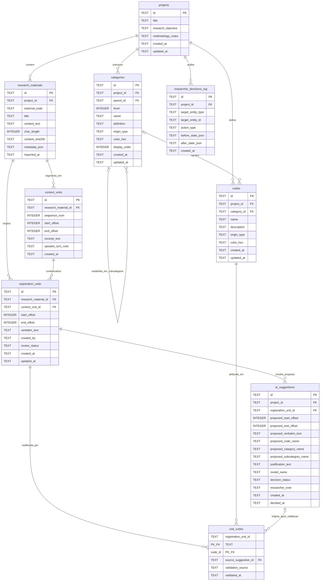

# Pesquisa Técnica: Modelo de Dados e Estrutura de Armazenamento Local do Projeto

- **Ticket de referência:** [#2 — \[Research\] Modelo de Dados e Estrutura de Armazenamento Local do Projeto](https://github.com/otavioalves-code/dIAlogo/issues/2)
- **Mapa arquitetural:** [#1 — \[MAP\] dIAlogo — Especificação e Arquitetura do Protótipo Funcional (MVP)](https://github.com/otavioalves-code/dIAlogo/issues/1)
- **Documentos de domínio respeitados:** `GLOSSARY.md`, `docs/adr/0001-protagonismo-pesquisador-analise-indutiva.md` e `docs/adr/0002-rastreabilidade-e-interface-painel-dividido.md`

---

## 1. Pergunta Investigada e Síntese da Recomendação

### Pergunta do Ticket

> *Qual estrutura de dados e modelo de persistência local (ex.: arquivo JSON estruturado ou SQLite leve) melhor atende às entidades do dIAlogo (Projeto, Entrevista/Material de Pesquisa, Unidade de Registro, Unidade de Contexto, Código, Categoria e Subcategoria), garantindo integridade das relações, persistência sem banco de dados externo e facilidade de exportação futura?*

### Síntese Executiva da Recomendação

Recomenda-se adotar uma **arquitetura híbrida complementar centrada em SQLite local**:

1. **Armazenamento primário de trabalho — SQLite em arquivo único local (`.dialogo.sqlite`):** todo o estado analítico do projeto é gravado localmente em um único arquivo SQLite embutido na própria aplicação, sem necessidade de instalar ou administrar qualquer servidor externo ([SQLite — Appropriate Uses For SQLite](https://www.sqlite.org/whentouse.html); [SQLite As An Application File Format](https://www.sqlite.org/appfileformat.html)).
2. **Intercâmbio, cópia de segurança legível e relatórios científicos — JSON estruturado (RFC 8259), CSV (RFC 4180) e Markdown/HTML:** gerados sob demanda diretamente a partir de consultas relacionais e das funções JSON nativas do próprio SQLite ([SQLite JSON Functions and Operators](https://www.sqlite.org/json1.html); [IETF RFC 8259](https://www.rfc-editor.org/rfc/rfc8259)), mantendo alinhamento estrutural com o padrão internacional de pesquisa qualitativa **REFI-QDA** ([REFI-QDA Standard — qdasoftware.org](https://www.qdasoftware.org/)).

### Breve Tradução dos Termos Técnicos Essenciais

Para facilitar a leitura por pesquisadores da área da saúde:

- **Banco de dados embutido (*embedded database*):** motor de armazenamento que funciona como uma biblioteca interna do aplicativo, gravando tudo em um arquivo comum no computador do próprio pesquisador (como um documento `.docx` ou `.pdf`), sem depender de internet nem de servidores externos.
- **Transação ACID (*Atomicidade, Consistência, Isolamento e Durabilidade*):** proteção que garante que cada ação do pesquisador (por exemplo, aceitar um `Código` e criar uma `Categoria` ao mesmo tempo) seja salva por inteiro ou desfeita com segurança caso o computador desligue ou o programa feche inesperadamente no meio da gravação.
- **Chave estrangeira (*foreign key*):** regra automática entre tabelas que impede "vínculos quebrados" — por exemplo, garante que toda `Unidade de Registro` sempre aponte para um `Material de Pesquisa` e uma `Unidade de Contexto` realmente existentes.
- **Índices de posição (*offsets* de caracteres — `start_offset` e `end_offset`):** números inteiros que marcam a posição exata do primeiro e do último caractere de um trecho grifado dentro da transcrição original, permitindo colorir o texto na tela dividida sem duplicar ou alterar a entrevista.
- **Resumo criptográfico SHA-256 (*hash SHA-256*):** código único calculado matematicamente a partir do texto da entrevista (como uma "impressão digital" do documento); se uma única vírgula ou espaço fosse alterado por acidente, o código mudaria imediatamente, alertando o sistema antes que os grifos saíssem do lugar.
- **Modo WAL (*Write-Ahead Logging*):** registro sequencial de gravação do SQLite que torna o salvamento contínuo mais rápido e permite que a interface leia os dados na tela ao mesmo tempo em que novas decisões ou sugestões preliminares da IA são gravadas em segundo plano.

---

## 2. Comparativo Técnico Fundamentado em Fontes Primárias

Na Análise de Conteúdo apoiada pelo dIAlogo, o modelo de armazenamento precisa sustentar simultaneamente:

- a **interface em painel dividido (*split-view*)** e a **rastreabilidade bidirecional estrita** entre `Categoria` / `Subcategoria`, `Código`, `Unidade de Registro`, `Unidade de Contexto` e `Material de Pesquisa` (`ADR 0002`);
- o **fluxo iterativo de revisão humana** de cada sugestão preliminar da IA — aceitar, editar ou rejeitar — sob o princípio do `Protagonismo do Pesquisador` (`ADR 0001`).

A tabela a seguir confronta as três alternativas principais de persistência local nos quatro critérios do ticket:

| Critério do Ticket | SQLite Local em Arquivo Único (Recomendado) | Arquivo JSON Estruturado Puro | IndexedDB / Armazenamento Interno do Navegador |
| :--- | :--- | :--- | :--- |
| **1. Integridade das relações e rastreabilidade bidirecional (`ADR 0002`)** | **Nativa e declarativa.** Suporta chaves primárias, chaves estrangeiras (`PRAGMA foreign_keys = ON`), restrições `UNIQUE`, `CHECK` e tabelas `STRICT` ([SQLite Foreign Keys](https://www.sqlite.org/foreignkeys.html); [STRICT Tables](https://www.sqlite.org/stricttables.html)). Consultas `JOIN` navegam instantaneamente da `Categoria` ao trecho literal e vice-versa. | **Inexistente no formato; depende 100% de código manual.** A especificação JSON ([RFC 8259](https://www.rfc-editor.org/rfc/rfc8259)) define apenas sintaxe textual; mesmo com validação via [JSON Schema](https://json-schema.org/), não há imposição nativa de integridade referencial cruzada nem ações em cascata (`CASCADE` / `SET NULL`). | **Limitada (orientada a objetos/chaves).** A especificação [W3C IndexedDB 3.0](https://www.w3.org/TR/IndexedDB-3/) oferece índices secundários e transações, mas não possui chaves estrangeiras declarativas nem consultas relacionais `JOIN` para cruzar múltiplos níveis analíticos. |
| **2. Persistência sem banco de dados externo** | **Excelente (zero configuração).** Opera sem processo servidor, gravando todo o projeto em um único arquivo portátil entre Windows, macOS e Linux ([SQLite Appropriate Uses](https://www.sqlite.org/whentouse.html)). Já vem embutido na biblioteca padrão do Python (`sqlite3`) e do Node.js moderno (`node:sqlite`). | **Excelente.** Requer apenas leitura e escrita de arquivo UTF-8 no sistema operacional, suportado nativamente em qualquer linguagem de programação. | **Restrita ao navegador e à origem (*origin-bound*).** Os dados ficam ocultos em diretórios internos do navegador, atrelados ao endereço/porta (`localhost:porta`), sujeitos a cotas e descarte (*eviction*) se não houver permissão persistente ([MDN Storage Quotas and Eviction](https://developer.mozilla.org/en-US/docs/Web/API/Storage_API/Storage_quotas_and_eviction_criteria)). |
| **3. Segurança durante revisões incrementais da IA (`ADR 0001`)** | **Muito alta (ACID em nível de página).** Cada clique em *Aceitar*, *Editar* ou *Rejeitar* grava apenas as páginas modificadas (tipicamente 4 KB) com atomicidade e durabilidade contra quedas de energia ou travamentos ([SQLite App File Format](https://www.sqlite.org/appfileformat.html); [Atomic Commit](https://www.sqlite.org/atomiccommit.html)). | **Frágil em atualizações contínuas.** Editar um único cartão exige serializar e reescrever o arquivo JSON inteiro (ou gerenciar múltiplos arquivos soltos, o antipadrão *pile-of-files*). Uma falha no meio da escrita ou duas gravações simultâneas podem truncar e corromper o projeto inteiro. | **Alta dentro do navegador, porém vulnerável à limpeza de dados.** Possui transações atômicas por *object store*, mas se o pesquisador limpar os dados do navegador ou trocar de navegador/computador sem exportar antes, perde o acesso direto ao arquivo do projeto. |
| **4. Facilidade de exportação futura e portabilidade** | **Muito alta.** O arquivo `.sqlite` já é um documento único copiável para backup; além disso, consultas SQL simples extraem matrizes CSV/Excel, relatórios de citações e snapshots JSON completos via extensão nativa JSON1 ([SQLite JSON1](https://www.sqlite.org/json1.html)). | **Alta para leitura bruta, trabalhosa para recortes tabulares.** O arquivo já está em JSON legível, mas gerar matrizes cruzadas (ex.: frequência de `Códigos` por `Categoria` e entrevista) exige varrer e cruzar vetores manualmente na aplicação. | **Baixa por padrão.** Não gera um arquivo visível na área de trabalho do pesquisador; toda cópia de segurança ou exportação exige programação explícita de rotinas de serialização e download pelo navegador. |

### Análise Detalhada das Evidências em Fontes Primárias

#### 2.1. Por que SQLite supera JSON puro como formato de arquivo de aplicação

A documentação arquitetural oficial do SQLite ([SQLite As An Application File Format](https://www.sqlite.org/appfileformat.html)) demonstra que um arquivo SQLite com esquema definido atua como substituto direto tanto de arquivos serializados monolíticos (como um grande `.json` regravado a cada edição) quanto de diretórios com dezenas de arquivos avulsos (*pile-of-files*):

1. **Atualizações incrementais e contínuas sem botão "Salvar" manual arriscado:** em um projeto qualitativo com 15 a 30 entrevistas transcritas, centenas de `Unidades de Registro` e centenas de cartões de sugestão preliminar da IA, um arquivo JSON único cresce rapidamente para vários megabytes. Em JSON puro, cada clique do pesquisador em **Aceitar**, **Editar** ou **Rejeitar** (`ADR 0002`) obriga a aplicação a reescrever o arquivo inteiro do zero (ou usar escrita em arquivo temporário seguida de renomeação atômica dependente do sistema operacional). No SQLite, apenas as páginas B-tree efetivamente alteradas são gravadas em uma transação ACID ([SQLite App File Format — Incremental And Continuous Updates](https://www.sqlite.org/appfileformat.html)).
2. **Concorrência segura entre leitura da interface e processamento assíncrono da IA:** quando configurado com `PRAGMA journal_mode = WAL;` ([Write-Ahead Logging](https://www.sqlite.org/wal.html)), leitores não bloqueiam escritores nem são bloqueados por eles. Assim, o pesquisador pode navegar fluentemente pelas entrevistas já importadas e revisar cartões na tela dividida enquanto, em segundo plano, a aplicação persiste novos lotes de sugestões preliminares da IA para outra entrevista.
3. **Integridade referencial obrigatória por conexão:** a documentação oficial alerta que, por compatibilidade histórica, o SQLite inicia conexões com verificação de chaves estrangeiras desligada; por isso, **toda conexão aberta pela aplicação deve executar imediatamente `PRAGMA foreign_keys = ON;`** ([SQLite Foreign Key Support — Enabling Foreign Key Support](https://www.sqlite.org/foreignkeys.html)). Com essa diretiva ativa e tabelas declaradas como `STRICT` (disponível desde o SQLite 3.37.0 — [STRICT Tables](https://www.sqlite.org/stricttables.html)), o próprio motor impede tipos inválidos e referências órfãs.
4. **Desempenho superior na leitura seletiva:** testes oficiais do projeto SQLite mostram que ler e gravar registros pequenos e médios estruturados em um único arquivo SQLite chega a ser cerca de 35% mais rápido do que abrir e gravar múltiplos arquivos pequenos separados no sistema de arquivos ([SQLite — 35% Faster Than The Filesystem](https://www.sqlite.org/fasterthanfs.html)).

#### 2.2. Suporte nativo sem dependências complexas nas plataformas de MVP

Um requisito central do protótipo é não exigir instalação de SGBD externo (como PostgreSQL ou MySQL) no computador do estudante ou pesquisador. O SQLite atende a esse critério nas três arquiteturas mais comuns de MVP local:

- **Python (aplicação web local com FastAPI, Flask ou Streamlit, ou desktop):** o módulo `sqlite3` integra a biblioteca padrão oficial do Python (compatível com PEP 249 / DB-API 2.0), sem instalar pacotes externos ([Python Standard Library — `sqlite3`](https://docs.python.org/3/library/sqlite3.html)).
- **Node.js / TypeScript (aplicação web local full-stack ou Electron/Tauri):** a partir do Node.js `v22.5.0` (disponível sem flag experimental desde `v22.13.0` e `v23.4.0`), o runtime inclui nativamente o módulo embutido `node:sqlite` (`DatabaseSync`), eliminando compilação nativa externa (`node-gyp`) para protótipos locais ([Node.js Documentation — `node:sqlite`](https://nodejs.org/api/sqlite.html)).
- **Execução 100% no navegador (caso futuramente desejado sem processo local):** a equipe oficial do SQLite mantém o pacote **SQLite WASM**, capaz de persistir um banco SQLite real dentro do *Origin Private File System* (OPFS, inclusive via `opfs-sahpool` sem exigir cabeçalhos HTTP especiais de isolamento de origem) e exportar/importar o arquivo `.sqlite` diretamente para o computador do usuário ([SQLite WASM Persistent Storage Options](https://sqlite.org/wasm/doc/trunk/persistence.md)). Mesmo nesse cenário, o modelo relacional SQLite permanece idêntico, ao contrário do IndexedDB puro.

#### 2.3. O papel legítimo do JSON (RFC 8259) e o alinhamento com o padrão REFI-QDA

Embora inadequado como armazenamento transacional único durante a codificação iterativa, o **JSON** ([RFC 8259](https://www.rfc-editor.org/rfc/rfc8259)) exige codificação UTF-8 sem *Byte Order Mark* (BOM) para interoperabilidade universal e pode ter sua estrutura formalmente validada por **JSON Schema** ([JSON Schema Specification](https://json-schema.org/)). No dIAlogo, o JSON cumpre dois papéis ideais:

1. **Formato estruturado de comunicação com o modelo de IA Generativa** (recebendo propostas preliminares de `Unidade de Registro`, `Código`, `Categoria` e justificativa antes de gravá-las em `ai_suggestions`);
2. **Formato portátil de exportação/snapshot legível por humanos e outros scripts.**

Adicionalmente, a consulta à especificação primária do padrão internacional **REFI-QDA** (`urn:QDA-XML:project:1.0` para projetos `.qdpx` e `urn:QDA-XML:codebook:1.0` para livros de códigos `.qdc` — [REFI-QDA Standard](https://www.qdasoftware.org/)) revela um princípio fundamental adotado por softwares consagrados de pesquisa qualitativa (como ATLAS.ti, MAXQDA, NVivo e QualCoder, que inclusive usa SQLite internamente):

- O documento original importado (`TextSource`) é mantido **intacto e imutável**;
- Cada segmento codificado (`PlainTextSelection`) aponta para o documento de origem por identificadores únicos (`guid`) e coordenadas inteiras exatas de caracteres baseadas em zero (`startPosition` e `endPosition`);
- O livro de códigos (`CodeBook`) representa hierarquias de categorias e códigos como árvore estruturada com identificadores estáveis, cor visual e descrição teórica (`Description`), vinculada aos segmentos por referências (`Coding` -> `CodeRef`).

Adotar esse mesmo desenho no esquema SQLite do dIAlogo garante não apenas o funcionamento perfeito da interface em painel dividido (`ADR 0002`), mas também compatibilidade conceitual direta caso versões futuras queiram exportar arquivos `.qdpx` ou `.qdc`.

---

## 3. Modelo Relacional de Entidades Proposto para o dIAlogo

> **Nota sobre privacidade e ética em saúde (`AGENTS.md`):** o dIAlogo pressupõe que todo `Material de Pesquisa` importado já esteja devidamente anonimizado. Todos os identificadores, trechos e metadados ilustrados nesta seção utilizam exclusivamente **dados sintéticos e fictícios**.

### 3.1. Decisões de Modelagem por Entidade do Domínio

#### 1. `projects` (Projeto)
Representa o estudo qualitativo conduzido pelo pesquisador (título, objetivo de pesquisa, notas metodológicas sobre o referencial de Análise de Conteúdo de Bardin e datas de criação/atualização). Permite que um único arquivo `.dialogo.sqlite` abrigue um projeto autocontido (padrão recomendado: um arquivo `.dialogo.sqlite` por pesquisa, facilitando backup e compartilhamento ético entre orientando e orientador) ou múltiplos projetos isolados por `project_id`.

#### 2. `research_materials` (`Material de Pesquisa`)
Armazena cada transcrição de entrevista ou documento textual anonimizado submetido à análise (`GLOSSARY.md`).
- **Imutabilidade pós-importação e integridade dos grifos (`ADR 0002`):** no momento da importação, o texto é normalizado em UTF-8 (com quebras de linha padronizadas para `\n` e normalização Unicode NFC) e gravado em `content_text` junto ao seu comprimento (`char_length`) e ao resumo criptográfico `content_sha256`. Um gatilho SQL (`TRIGGER`) bloqueia alterações posteriores em `content_text` assim que houver unidades demarcadas. Isso impede que a edição acidental de um caractere desloque todos os índices `start_offset` e `end_offset` dos realces visuais na **Coluna da Esquerda** da interface em painel dividido.
- **Perfil sintético/anonimizado flexível:** uma coluna opcional `metadata_json` validada por `CHECK (json_valid(metadata_json))` ([SQLite JSON1](https://www.sqlite.org/json1.html)) permite guardar variáveis caracterizadoras não identificáveis (ex.: categoria profissional ou faixa etária agregada) sem engessar o esquema.

#### 3. `context_units` (`Unidade de Contexto`)
Representa o trecho textual mais amplo que circunda a fala recortada — tipicamente o par pergunta do entrevistador + resposta completa do participante, ou um bloco temático contínuo da entrevista (`GLOSSARY.md`).
- Possui `start_offset`, `end_offset` (convenção semiaberta `[start_offset, end_offset)` em pontos de código Unicode, iniciando em `0`, idêntica a fatias Python/JavaScript e ao `PlainTextSelection` do REFI-QDA) e `excerpt_text`.
- Sua presença explícita no banco viabiliza a exigência central do `ADR 0002`: ao inspecionar qualquer `Categoria`, `Subcategoria` ou `Código`, o pesquisador recupera imediatamente não só a frase isolada, mas o contexto dialógico completo em que ela foi dita.

#### 4. `registration_units` (`Unidade de Registro`)
Representa o menor segmento de texto na fala do entrevistado (frase, parágrafo ou enunciado) com sentido completo e relevância temática (`GLOSSARY.md`).
- **Duplo vínculo obrigatório:** aponta para `research_material_id` (`ON DELETE CASCADE`, caso o pesquisador exclua uma entrevista inteira do projeto) e obrigatoriamente para `context_unit_id` (`ON DELETE RESTRICT`, impedindo que uma `Unidade de Contexto` seja apagada enquanto houver `Unidades de Registro` apoiadas nela).
- **Coordenadas e citação literal:** armazena `start_offset`, `end_offset` (contidos dentro dos limites da sua `Unidade de Contexto`) e `verbatim_text`, garantindo que o grifo colorido na Coluna da Esquerda (`ADR 0002`) corresponda caractere por caractere à fala original.
- **Autoria e estado de validação:** registra `created_by` (`'ia'` ou `'pesquisador'`) e `review_status` (`'pendente_ia'`, `'validada'`, `'rejeitada'`). Dessa forma, um recorte sugerido pela IA aparece demarcado visualmente para avaliação na tela dividida, mas **só ingressa no corpus analítico validado quando aprovado ou ajustado pelo pesquisador** (`ADR 0001`).

#### 5. `categories` (`Categoria` e `Subcategoria`)
Modela as classes conceituais superiores (`Categoria`) e suas subdivisões temáticas (`Subcategoria`) por meio de uma tabela única auto-referenciada (`parent_id REFERENCES categories(id) ON DELETE RESTRICT`) com **restrição explícita a dois níveis hierárquicos** (`level INTEGER NOT NULL CHECK (level IN (1, 2))`):
- Quando `level = 1`, `parent_id` é obrigatoriamente `NULL` -> trata-se de uma **`Categoria`**.
- Quando `level = 2`, `parent_id` é obrigatoriamente não nulo e validado por *trigger* para apontar exclusivamente para um registro de `level = 1` -> trata-se de uma **`Subcategoria`**.
- **Por que esta escolha supera duas tabelas separadas?**
  1. Um `Código` pode ser agrupado diretamente em uma `Categoria` (quando aquela temática não exige subdivisão) **ou** refinado dentro de uma `Subcategoria`, usando uma única chave estrangeira limpa (`codes.category_id`), sem precisar de duas colunas mutuamente exclusivas;
  2. Alimenta diretamente o componente visual de árvore expansível previsto na interface (`ADR 0002`) e mapeia sem atrito para a árvore `<CodeBook>` do padrão REFI-QDA;
  3. Inclui `origin_type` (`'indutiva'` ou `'a_priori'`) e `definition` (critério semântico de inclusão), contemplando tanto categorias emergentes da leitura quanto categorias teóricas definidas *a priori* (`ADR 0001`).

#### 6. `codes` (`Código`)
Armazena os rótulos conceituais ou etiquetas semânticas atribuídas às `Unidades de Registro` (`GLOSSARY.md`).
- **Vínculo opcional com `categories` (`category_id ... ON DELETE SET NULL`):** na etapa de codificação aberta indutiva de Bardin (`ADR 0001`), o pesquisador frequentemente cria ou aceita `Códigos` emergentes **antes** de decidir em qual `Categoria` ou `Subcategoria` eles serão agrupados. Permitir `category_id IS NULL` respeita o tempo metodológico da análise; além disso, `ON DELETE SET NULL` garante que, se o pesquisador dissolver uma `Subcategoria` durante a reorganização temática, os `Códigos` já trabalhados não sejam perdidos — apenas retornam ao estado "sem agrupamento" para nova alocação.
- Também registra `origin_type` (`'indutivo'` ou `'a_priori'`), `description` e `color_hex`.

#### 7. `ai_suggestions`, `unit_codes` e `researcher_decisions_log` (Separação entre Sugestão da IA e Validação Humana)
Para honrar rigorosamente o `Protagonismo do Pesquisador` (`ADR 0001`) e a mecânica dos cartões na **Coluna da Direita** da *split-view* (`ADR 0002`), o modelo separa em tabelas distintas a **proposta preliminar da IA** e o **vínculo analítico consolidado**:

1. **`ai_suggestions` (Cartões de sugestão preliminar da IA):** cada cartão gerado pela IA registra o trecho sugerido (`registration_unit_id` em estado `'pendente_ia'`, além das coordenadas originais propostas `proposed_start_offset` e `proposed_end_offset`), o `Código` proposto (`proposed_code_name`), a `Categoria` / `Subcategoria` sugerida (`proposed_category_name` e `proposed_subcategory_name`), a **justificativa textual baseada no trecho** (`justification_text` — exigida pelo `ADR 0002`) e o estado da decisão (`decision_status`: `'pendente'`, `'aceita'`, `'editada'` ou `'rejeitada'`).
2. **`unit_codes` (Codificações efetivamente validadas pelo pesquisador):** tabela associativa (`N:N`, pois uma mesma `Unidade de Registro` rica pode expressar mais de um `Código` em certos recortes analíticos, e um `Código` agrupa múltiplas `Unidades de Registro`). **Somente entram em `unit_codes` decisões validadas pelo pesquisador** — seja ao clicar em *Aceitar* (`validation_source = 'ia_aceita'`), ao clicar em *Editar* ajustando recorte/rótulo (`validation_source = 'ia_editada'`), ou ao codificar manualmente do zero (`validation_source = 'manual_pesquisador'`). Referencia opcionalmente `source_suggestion_id` (`ON DELETE SET NULL`) para preservar o elo histórico com a sugestão original.
3. **`researcher_decisions_log` (Trilha de auditoria metodológica):** tabela somente de acréscimo (*append-only*) que grava cada ato decisório do pesquisador (data/hora, tipo de ação, estado anterior e estado resultante em JSON), documentando de maneira auditável para bancas, pareceristas e relatórios metodológicos como o pesquisador refinou, aceitou ou descartou as inferências preliminares da IA.

---

### 3.2. Diagrama Entidade-Relacionamento (`erDiagram`)



---

### 3.3. Esboço Ilustrativo de Esquema SQL DDL (SQLite `STRICT`) com Dados Sintéticos

O esquema abaixo utiliza identificadores textuais universais (UUIDv4 ou ULID em formato `TEXT`, facilitando futura exportação para XML/JSON do REFI-QDA sem colisão de chaves), datas em padrão ISO-8601 UTC (`TEXT`) e tabelas `STRICT`.

```sql
-- Diretivas obrigatórias na abertura de cada conexão da aplicação:
PRAGMA foreign_keys = ON;
PRAGMA journal_mode = WAL;
PRAGMA synchronous = NORMAL;

-- 1. Projeto de Pesquisa Qualitativa
CREATE TABLE IF NOT EXISTS projects (
    id TEXT PRIMARY KEY,
    title TEXT NOT NULL,
    research_objective TEXT NOT NULL DEFAULT '',
    methodology_notes TEXT NOT NULL DEFAULT '',
    created_at TEXT NOT NULL DEFAULT (strftime('%Y-%m-%dT%H:%M:%fZ', 'now')),
    updated_at TEXT NOT NULL DEFAULT (strftime('%Y-%m-%dT%H:%M:%fZ', 'now'))
) STRICT;

-- 2. Material de Pesquisa (transcrições anonimizadas e imutáveis após demarcação)
CREATE TABLE IF NOT EXISTS research_materials (
    id TEXT PRIMARY KEY,
    project_id TEXT NOT NULL REFERENCES projects(id) ON DELETE CASCADE,
    external_code TEXT NOT NULL, -- Ex.: 'E01', 'E02' (identificador sintético/anonimizado)
    title TEXT NOT NULL,
    content_text TEXT NOT NULL,
    char_length INTEGER NOT NULL CHECK (char_length = length(content_text)),
    content_sha256 TEXT NOT NULL CHECK (length(content_sha256) = 64),
    metadata_json TEXT NOT NULL DEFAULT '{}' CHECK (json_valid(metadata_json)),
    imported_at TEXT NOT NULL DEFAULT (strftime('%Y-%m-%dT%H:%M:%fZ', 'now')),
    UNIQUE (project_id, external_code)
) STRICT;

-- Proteção de imutabilidade: impede alterar o texto base após existirem unidades demarcadas
CREATE TRIGGER IF NOT EXISTS trg_prevent_material_text_mutation
BEFORE UPDATE OF content_text, content_sha256 ON research_materials
WHEN EXISTS (
    SELECT 1 FROM context_units WHERE research_material_id = OLD.id
) OR EXISTS (
    SELECT 1 FROM registration_units WHERE research_material_id = OLD.id
)
BEGIN
    SELECT RAISE(ABORT, 'O texto do Material de Pesquisa e imutavel apos demarcar unidades para preservar os offsets.');
END;

-- 3. Unidade de Contexto (ex.: pergunta do entrevistador + resposta completa)
CREATE TABLE IF NOT EXISTS context_units (
    id TEXT PRIMARY KEY,
    research_material_id TEXT NOT NULL REFERENCES research_materials(id) ON DELETE CASCADE,
    sequence_num INTEGER NOT NULL CHECK (sequence_num >= 1),
    start_offset INTEGER NOT NULL CHECK (start_offset >= 0),
    end_offset INTEGER NOT NULL CHECK (end_offset > start_offset),
    excerpt_text TEXT NOT NULL,
    speaker_turn_note TEXT NOT NULL DEFAULT '',
    created_at TEXT NOT NULL DEFAULT (strftime('%Y-%m-%dT%H:%M:%fZ', 'now')),
    UNIQUE (research_material_id, sequence_num)
) STRICT;

-- 4. Unidade de Registro (menor segmento temático com sentido completo na fala)
CREATE TABLE IF NOT EXISTS registration_units (
    id TEXT PRIMARY KEY,
    research_material_id TEXT NOT NULL REFERENCES research_materials(id) ON DELETE CASCADE,
    context_unit_id TEXT NOT NULL REFERENCES context_units(id) ON DELETE RESTRICT,
    start_offset INTEGER NOT NULL CHECK (start_offset >= 0),
    end_offset INTEGER NOT NULL CHECK (end_offset > start_offset),
    verbatim_text TEXT NOT NULL,
    created_by TEXT NOT NULL CHECK (created_by IN ('ia', 'pesquisador')),
    review_status TEXT NOT NULL CHECK (review_status IN ('pendente_ia', 'validada', 'rejeitada')),
    created_at TEXT NOT NULL DEFAULT (strftime('%Y-%m-%dT%H:%M:%fZ', 'now')),
    updated_at TEXT NOT NULL DEFAULT (strftime('%Y-%m-%dT%H:%M:%fZ', 'now'))
) STRICT;

-- Garante que toda Unidade de Registro pertença ao mesmo Material de Pesquisa e esteja contida nos offsets de sua Unidade de Contexto
CREATE TRIGGER IF NOT EXISTS trg_validate_registration_unit_bounds
BEFORE INSERT ON registration_units
BEGIN
    SELECT CASE
        WHEN NOT EXISTS (
            SELECT 1 FROM context_units cu
            WHERE cu.id = NEW.context_unit_id
              AND cu.research_material_id = NEW.research_material_id
              AND NEW.start_offset >= cu.start_offset
              AND NEW.end_offset <= cu.end_offset
        )
        THEN RAISE(ABORT, 'A Unidade de Registro deve estar contida nos offsets da sua Unidade de Contexto.')
    END;
END;

CREATE TRIGGER IF NOT EXISTS trg_validate_registration_unit_bounds_update
BEFORE UPDATE OF research_material_id, context_unit_id, start_offset, end_offset ON registration_units
BEGIN
    SELECT CASE
        WHEN NOT EXISTS (
            SELECT 1 FROM context_units cu
            WHERE cu.id = NEW.context_unit_id
              AND cu.research_material_id = NEW.research_material_id
              AND NEW.start_offset >= cu.start_offset
              AND NEW.end_offset <= cu.end_offset
        )
        THEN RAISE(ABORT, 'A Unidade de Registro atualizada deve permanecer contida na sua Unidade de Contexto.')
    END;
END;

-- 5. Categoria (level = 1) e Subcategoria (level = 2)
CREATE TABLE IF NOT EXISTS categories (
    id TEXT PRIMARY KEY,
    project_id TEXT NOT NULL REFERENCES projects(id) ON DELETE CASCADE,
    parent_id TEXT REFERENCES categories(id) ON DELETE RESTRICT,
    level INTEGER NOT NULL CHECK (level IN (1, 2)),
    name TEXT NOT NULL,
    definition TEXT NOT NULL DEFAULT '',
    origin_type TEXT NOT NULL CHECK (origin_type IN ('indutiva', 'a_priori')),
    color_hex TEXT NOT NULL DEFAULT '#2563EB',
    display_order INTEGER NOT NULL DEFAULT 0,
    created_at TEXT NOT NULL DEFAULT (strftime('%Y-%m-%dT%H:%M:%fZ', 'now')),
    updated_at TEXT NOT NULL DEFAULT (strftime('%Y-%m-%dT%H:%M:%fZ', 'now')),
    CHECK ((level = 1 AND parent_id IS NULL) OR (level = 2 AND parent_id IS NOT NULL)),
    UNIQUE (project_id, parent_id, name)
) STRICT;

-- Impede mais de 2 níveis (toda Subcategoria deve apontar para uma Categoria de nível 1 do mesmo Projeto)
CREATE TRIGGER IF NOT EXISTS trg_validate_subcategory_parent
BEFORE INSERT ON categories
WHEN NEW.level = 2
BEGIN
    SELECT CASE
        WHEN NOT EXISTS (
            SELECT 1 FROM categories p
            WHERE p.id = NEW.parent_id
              AND p.project_id = NEW.project_id
              AND p.level = 1
        )
        THEN RAISE(ABORT, 'Uma Subcategoria (level=2) deve estar vinculada a uma Categoria raiz (level=1) do mesmo projeto.')
    END;
END;

CREATE TRIGGER IF NOT EXISTS trg_validate_subcategory_parent_update
BEFORE UPDATE OF parent_id, level, project_id ON categories
WHEN NEW.level = 2
BEGIN
    SELECT CASE
        WHEN NOT EXISTS (
            SELECT 1 FROM categories p
            WHERE p.id = NEW.parent_id
              AND p.project_id = NEW.project_id
              AND p.level = 1
        )
        THEN RAISE(ABORT, 'Uma Subcategoria (level=2) deve permanecer vinculada a uma Categoria raiz (level=1) do mesmo projeto.')
    END;
END;

-- 6. Código (rótulo semântico; category_id opcional para suportar codificação aberta indutiva)
CREATE TABLE IF NOT EXISTS codes (
    id TEXT PRIMARY KEY,
    project_id TEXT NOT NULL REFERENCES projects(id) ON DELETE CASCADE,
    category_id TEXT REFERENCES categories(id) ON DELETE SET NULL,
    name TEXT NOT NULL,
    description TEXT NOT NULL DEFAULT '',
    origin_type TEXT NOT NULL CHECK (origin_type IN ('indutivo', 'a_priori')),
    color_hex TEXT NOT NULL DEFAULT '#0D9488',
    created_at TEXT NOT NULL DEFAULT (strftime('%Y-%m-%dT%H:%M:%fZ', 'now')),
    updated_at TEXT NOT NULL DEFAULT (strftime('%Y-%m-%dT%H:%M:%fZ', 'now')),
    UNIQUE (project_id, name)
) STRICT;

-- 7. Cartões de Sugestão Preliminar da IA (Coluna da Direita na split-view — ADR 0002)
CREATE TABLE IF NOT EXISTS ai_suggestions (
    id TEXT PRIMARY KEY,
    project_id TEXT NOT NULL REFERENCES projects(id) ON DELETE CASCADE,
    registration_unit_id TEXT NOT NULL REFERENCES registration_units(id) ON DELETE CASCADE,
    proposed_start_offset INTEGER NOT NULL CHECK (proposed_start_offset >= 0),
    proposed_end_offset INTEGER NOT NULL CHECK (proposed_end_offset > proposed_start_offset),
    proposed_verbatim_text TEXT NOT NULL,
    proposed_code_name TEXT NOT NULL,
    proposed_category_name TEXT NOT NULL DEFAULT '',
    proposed_subcategory_name TEXT NOT NULL DEFAULT '',
    justification_text TEXT NOT NULL, -- Justificativa explícita baseada no trecho (ADR 0002)
    model_name TEXT NOT NULL DEFAULT '',
    decision_status TEXT NOT NULL DEFAULT 'pendente'
        CHECK (decision_status IN ('pendente', 'aceita', 'editada', 'rejeitada')),
    researcher_note TEXT NOT NULL DEFAULT '',
    created_at TEXT NOT NULL DEFAULT (strftime('%Y-%m-%dT%H:%M:%fZ', 'now')),
    decided_at TEXT
) STRICT;

-- 8. Vínculos Validados entre Unidade de Registro e Código (Protagonismo do Pesquisador — ADR 0001)
CREATE TABLE IF NOT EXISTS unit_codes (
    registration_unit_id TEXT NOT NULL REFERENCES registration_units(id) ON DELETE CASCADE,
    code_id TEXT NOT NULL REFERENCES codes(id) ON DELETE RESTRICT,
    source_suggestion_id TEXT REFERENCES ai_suggestions(id) ON DELETE SET NULL,
    validation_source TEXT NOT NULL CHECK (validation_source IN ('ia_aceita', 'ia_editada', 'manual_pesquisador')),
    validated_at TEXT NOT NULL DEFAULT (strftime('%Y-%m-%dT%H:%M:%fZ', 'now')),
    PRIMARY KEY (registration_unit_id, code_id)
) STRICT;

-- Impede associar Códigos definitivos a uma Unidade de Registro ainda não validada pelo pesquisador
CREATE TRIGGER IF NOT EXISTS trg_require_validated_unit_on_coding
BEFORE INSERT ON unit_codes
BEGIN
    SELECT CASE
        WHEN NOT EXISTS (
            SELECT 1 FROM registration_units ru
            WHERE ru.id = NEW.registration_unit_id
              AND ru.review_status = 'validada'
        )
        THEN RAISE(ABORT, 'Somente Unidades de Registro validadas pelo pesquisador podem receber Codigos consolidados.')
    END;
END;

-- 9. Histórico Auditável de Decisões do Pesquisador
CREATE TABLE IF NOT EXISTS researcher_decisions_log (
    id TEXT PRIMARY KEY,
    project_id TEXT NOT NULL REFERENCES projects(id) ON DELETE CASCADE,
    target_entity_type TEXT NOT NULL CHECK (
        target_entity_type IN ('registration_unit', 'code', 'category', 'ai_suggestion', 'unit_code')
    ),
    target_entity_id TEXT NOT NULL,
    action_type TEXT NOT NULL CHECK (
        action_type IN ('aceitar_sugestao', 'editar_sugestao', 'rejeitar_sugestao', 'criar_manual', 'renomear', 'reagrupar', 'excluir')
    ),
    before_state_json TEXT NOT NULL DEFAULT '{}' CHECK (json_valid(before_state_json)),
    after_state_json TEXT NOT NULL DEFAULT '{}' CHECK (json_valid(after_state_json)),
    created_at TEXT NOT NULL DEFAULT (strftime('%Y-%m-%dT%H:%M:%fZ', 'now'))
) STRICT;

-- Índices essenciais para resposta instantânea na interface em painel dividido (ADR 0002)
CREATE INDEX IF NOT EXISTS idx_materials_project ON research_materials(project_id);
CREATE INDEX IF NOT EXISTS idx_context_units_material ON context_units(research_material_id, start_offset);
CREATE INDEX IF NOT EXISTS idx_reg_units_material_status ON registration_units(research_material_id, review_status, start_offset);
CREATE INDEX IF NOT EXISTS idx_reg_units_context ON registration_units(context_unit_id);
CREATE INDEX IF NOT EXISTS idx_categories_tree ON categories(project_id, parent_id, display_order);
CREATE INDEX IF NOT EXISTS idx_codes_category ON codes(project_id, category_id);
CREATE INDEX IF NOT EXISTS idx_suggestions_status ON ai_suggestions(project_id, decision_status);
CREATE INDEX IF NOT EXISTS idx_unit_codes_code ON unit_codes(code_id);
```

#### Exemplo Sintético de Fluxo Completo (Fictício)

Para ilustrar como os índices de caracteres (`start_offset` e `end_offset`) e o `Protagonismo do Pesquisador` operam na prática, considere um depoimento fictício `E01` com `193` caracteres:

- **Texto integral anonimizado (`research_materials.content_text`):**
  `Entrevistador: Como foi o acolhimento na unidade? Participante Fictício P01: Fui bem recebido na recepção, mas esperei três horas sem saber o motivo da demora, o que me deixou bastante ansioso.`
- **`Unidade de Contexto` (`start_offset = 0`, `end_offset = 193`):** abrange a pergunta inteira do entrevistador e a resposta integral do participante fictício `P01`.
- **`Unidade de Registro` sugerida pela IA e revisada pelo pesquisador (`start_offset = 111`, `end_offset = 192`):**
  `"esperei três horas sem saber o motivo da demora, o que me deixou bastante ansioso"`
- **Cartão em `ai_suggestions`:** propôs inicialmente o `Código` *"Falta de informação na espera"*, `Categoria` *"Acolhimento e Comunicação"*, `Subcategoria` *"Comunicação sobre tempo de espera"*, com justificativa explícita. O pesquisador clicou em **Editar**, refinou o `Código` para *"Ansiedade por falta de informação na espera"*, atualizou `registration_units.review_status = 'validada'`, consolidou o vínculo em `unit_codes` (`validation_source = 'ia_editada'`) e registrou a decisão em `researcher_decisions_log`.

---

## 4. Estratégia de Exportação e Portabilidade

Um grande benefício da escolha do SQLite local é que **todas as exportações exigidas na rotina científica do pesquisador derivam de consultas relacionais diretas**, sem depender de ferramentas externas:

### 4.1. Matriz Analítica para CSV / Planilhas Eletrônicas (RFC 4180 / Excel / LibreOffice)

Gera uma tabela plana pronta para ser exportada como arquivo `.csv` ([RFC 4180](https://www.rfc-editor.org/rfc/rfc4180) — recomenda-se incluir cabeçalho explícito e opção UTF-8 para abertura direta no Excel), listando exclusivamente dados validados pelo pesquisador:

```sql
SELECT
    COALESCE(cat_root.name, cat_direct.name, '(Sem Categoria)') AS categoria,
    CASE
        WHEN cat_direct.level = 2 THEN cat_direct.name
        ELSE '(Sem Subcategoria)'
    END AS subcategoria,
    c.name AS codigo,
    rm.external_code AS entrevista,
    ru.verbatim_text AS unidade_de_registro,
    cu.excerpt_text AS unidade_de_contexto,
    uc.validation_source AS origem_validacao,
    uc.validated_at AS data_validacao
FROM unit_codes uc
JOIN registration_units ru ON ru.id = uc.registration_unit_id
JOIN context_units cu ON cu.id = ru.context_unit_id
JOIN research_materials rm ON rm.id = ru.research_material_id
JOIN codes c ON c.id = uc.code_id
LEFT JOIN categories cat_direct ON cat_direct.id = c.category_id
LEFT JOIN categories cat_root ON cat_root.id = cat_direct.parent_id
WHERE rm.project_id = :project_id
  AND ru.review_status = 'validada'
ORDER BY categoria, subcategoria, codigo, rm.external_code, ru.start_offset;
```

### 4.2. Relatório de Citações Literais e Síntese de Frequências para Artigos e Dissertações

Na redação dos resultados de uma Análise de Conteúdo segundo Bardin, o pesquisador precisa tanto da distribuição quantitativa simples (quantas `Unidades de Registro` e quantas entrevistas sustentam cada `Categoria` / `Subcategoria` / `Código`) quanto do caderno de citações literais acompanhadas de suas `Unidades de Contexto` (`ADR 0002`):

```sql
SELECT
    COALESCE(cat_root.name, cat_direct.name, '(Nao agrupado)') AS categoria,
    CASE WHEN cat_direct.level = 2 THEN cat_direct.name ELSE '-' END AS subcategoria,
    c.name AS codigo,
    COUNT(DISTINCT ru.id) AS total_unidades_registro,
    COUNT(DISTINCT rm.id) AS total_entrevistas
FROM codes c
LEFT JOIN categories cat_direct ON cat_direct.id = c.category_id
LEFT JOIN categories cat_root ON cat_root.id = cat_direct.parent_id
LEFT JOIN unit_codes uc ON uc.code_id = c.id
LEFT JOIN registration_units ru ON ru.id = uc.registration_unit_id AND ru.review_status = 'validada'
LEFT JOIN research_materials rm ON rm.id = ru.research_material_id
WHERE c.project_id = :project_id
GROUP BY categoria, subcategoria, c.id, c.name
ORDER BY total_unidades_registro DESC, categoria, codigo;
```

### 4.3. Snapshot Portátil Completo em `.json` (RFC 8259) e Ponte Futura para REFI-QDA (`.qdpx` / `.qdc`)

Usando as funções nativas `json_object()` e `json_group_array()` embutidas por padrão desde o SQLite 3.38.0 ([SQLite JSON1](https://www.sqlite.org/json1.html)), a aplicação pode exportar com uma única consulta um retrato completo, legível e determinístico `.json` (em UTF-8 sem BOM conforme [RFC 8259](https://www.rfc-editor.org/rfc/rfc8259)):

```sql
SELECT json_object(
    'schema_version', '1.0',
    'exported_at', strftime('%Y-%m-%dT%H:%M:%fZ', 'now'),
    'project', json_object(
        'id', p.id,
        'title', p.title,
        'research_objective', p.research_objective,
        'methodology_notes', p.methodology_notes
    ),
    'categories', COALESCE((
        SELECT json_group_array(
            json_object(
                'id', cat.id,
                'parent_id', cat.parent_id,
                'level', cat.level,
                'name', cat.name,
                'definition', cat.definition,
                'origin_type', cat.origin_type,
                'color_hex', cat.color_hex
            )
        )
        FROM (
            SELECT * FROM categories
            WHERE project_id = p.id
            ORDER BY level, display_order, name
        ) cat
    ), json('[]')),
    'codes', COALESCE((
        SELECT json_group_array(
            json_object(
                'id', cd.id,
                'category_id', cd.category_id,
                'name', cd.name,
                'description', cd.description,
                'origin_type', cd.origin_type,
                'color_hex', cd.color_hex
            )
        )
        FROM (
            SELECT * FROM codes
            WHERE project_id = p.id
            ORDER BY name
        ) cd
    ), json('[]')),
    'research_materials', COALESCE((
        SELECT json_group_array(
            json_object(
                'id', rm.id,
                'external_code', rm.external_code,
                'title', rm.title,
                'content_sha256', rm.content_sha256,
                'content_text', rm.content_text
            )
        )
        FROM (
            SELECT * FROM research_materials
            WHERE project_id = p.id
            ORDER BY external_code
        ) rm
    ), json('[]')),
    'validated_codings', COALESCE((
        SELECT json_group_array(
            json_object(
                'registration_unit_id', vc.registration_unit_id,
                'research_material_id', vc.research_material_id,
                'context_unit_id', vc.context_unit_id,
                'start_offset', vc.start_offset,
                'end_offset', vc.end_offset,
                'verbatim_text', vc.verbatim_text,
                'code_id', vc.code_id,
                'validation_source', vc.validation_source,
                'validated_at', vc.validated_at
            )
        )
        FROM (
            SELECT
                ru.id AS registration_unit_id,
                ru.research_material_id,
                ru.context_unit_id,
                ru.start_offset,
                ru.end_offset,
                ru.verbatim_text,
                uc.code_id,
                uc.validation_source,
                uc.validated_at
            FROM unit_codes uc
            JOIN registration_units ru ON ru.id = uc.registration_unit_id
            JOIN research_materials rm ON rm.id = ru.research_material_id
            WHERE rm.project_id = p.id AND ru.review_status = 'validada'
            ORDER BY rm.external_code, ru.start_offset, uc.code_id
        ) vc
    ), json('[]'))
) AS project_snapshot_json
FROM projects p
WHERE p.id = :project_id;
```

> **Compatibilidade direta com REFI-QDA:** caso uma versão posterior do dIAlogo deseje interoperar com ATLAS.ti, MAXQDA, NVivo ou QualCoder, o mapeamento a partir deste esquema SQLite é direto e sem perda:
> - `categories` + `codes` -> árvore XML `<CodeBook>` (`urn:QDA-XML:codebook:1.0`, arquivo `.qdc`);
> - `research_materials` -> `<TextSource>` com arquivos `.txt` UTF-8 imutáveis no arquivo compactado `.qdpx`;
> - `registration_units` (`start_offset`, `end_offset`) + `unit_codes` -> `<PlainTextSelection startPosition="..." endPosition="...">` contendo `<Coding><CodeRef targetGUID="..."/></Coding>` (`urn:QDA-XML:project:1.0`).

---

## 5. Fontes Primárias Consultadas

1. **SQLite Consortium — *Appropriate Uses For SQLite*:** <https://www.sqlite.org/whentouse.html>  
   Fundamenta o uso do SQLite sem servidor como formato de arquivo local de aplicações desktop/web locais, portabilidade binária entre sistemas operacionais e ausência de administração externa.
2. **SQLite Consortium — *SQLite As An Application File Format*:** <https://www.sqlite.org/appfileformat.html>  
   Demonstra a superioridade de arquivos únicos SQLite com atualizações incrementais em nível de página e transações ACID sobre arquivos serializados monolíticos (como JSON reescrito por inteiro) e diretórios *pile-of-files*.
3. **SQLite Consortium — *Atomic Commit In SQLite*:** <https://www.sqlite.org/atomiccommit.html>  
   Documenta as garantias de durabilidade contra corrupção em quedas de energia ou falhas inesperadas no meio de uma escrita.
4. **SQLite Consortium — *35% Faster Than The Filesystem*:** <https://www.sqlite.org/fasterthanfs.html>  
   Apresenta medições primárias comparando leitura/escrita em banco SQLite único versus múltiplos arquivos pequenos no sistema de arquivos.
5. **SQLite Consortium — *SQLite Foreign Key Support*:** <https://www.sqlite.org/foreignkeys.html>  
   Especifica a obrigatoriedade de `PRAGMA foreign_keys = ON;` por conexão e o funcionamento de `ON DELETE CASCADE`, `ON DELETE RESTRICT` e `ON DELETE SET NULL`.
6. **SQLite Consortium — *STRICT Tables*:** <https://www.sqlite.org/stricttables.html>  
   Especifica a verificação estrita de tipos de dados introduzida no SQLite 3.37.0.
7. **SQLite Consortium — *Write-Ahead Logging (WAL)*:** <https://www.sqlite.org/wal.html>  
   Documenta a concorrência entre múltiplos leitores e um escritor sem bloqueio mútuo (`PRAGMA journal_mode = WAL;`).
8. **SQLite Consortium — *JSON Functions And Operators (JSON1 / JSONB)*:** <https://www.sqlite.org/json1.html>  
   Documenta `json_valid()`, `json_object()`, `json_group_array()` e operadores nativos para validação e exportação JSON dentro do SQLite.
9. **SQLite Consortium — *SQLite WASM Persistent Storage Options*:** <https://sqlite.org/wasm/doc/trunk/persistence.md> (índice geral: <https://sqlite.org/wasm/doc/trunk/index.md>)  
   Documenta a execução oficial do SQLite no navegador com persistência em OPFS (`opfs` e `opfs-sahpool`).
10. **Python Software Foundation — *`sqlite3` — DB-API 2.0 interface for SQLite databases*:** <https://docs.python.org/3/library/sqlite3.html>  
    Confirma suporte nativo na biblioteca padrão do Python sem dependências externas.
11. **OpenJS Foundation — *Node.js `node:sqlite` Documentation*:** <https://nodejs.org/api/sqlite.html>  
    Confirma o módulo nativo embutido `node:sqlite` (`DatabaseSync`, introduzido no Node.js v22.5.0 e sem flag experimental a partir do v22.13.0 / v23.4.0).
12. **IETF RFC 8259 (STD 90) — *The JavaScript Object Notation (JSON) Data Interchange Format*:** <https://www.rfc-editor.org/rfc/rfc8259>  
    Define a gramática oficial do JSON e a exigência de codificação UTF-8 sem BOM para intercâmbio aberto entre sistemas.
13. **JSON Schema Organization — *JSON Schema Specification*:** <https://json-schema.org/>  
    Especifica o vocabulário declarativo para validação estrutural de documentos JSON e seus limites frente a restrições relacionais dinâmicas.
14. **IETF RFC 4180 — *Common Format and MIME Type for Comma-Separated Values (CSV) Files*:** <https://www.rfc-editor.org/rfc/rfc4180>  
    Define as regras de formatação e escape de aspas/quebras de linha para exportação segura de textos longos de entrevistas em planilhas CSV.
15. **W3C Recommendation / Working Draft — *Indexed Database API 3.0*:** <https://www.w3.org/TR/IndexedDB-3/> e **MDN Web Docs — *Storage quotas and eviction criteria*:** <https://developer.mozilla.org/en-US/docs/Web/API/Storage_API/Storage_quotas_and_eviction_criteria>  
    Documentam o isolamento por origem (*same-origin*), ausência de SQL/chaves estrangeiras relacionais e políticas de cota/descarte do armazenamento interno de navegadores.
16. **Rotterdam Exchange Format Initiative — *REFI-QDA Standard (Codebook `.qdc` & Project `.qdpx`)*:** <https://www.qdasoftware.org/>  
    Referência internacional para softwares de análise de dados qualitativos (QDAS), especificando `TextSource` imutável, `PlainTextSelection` por coordenadas inteiras `startPosition`/`endPosition` e hierarquia de códigos `<CodeBook>`.
